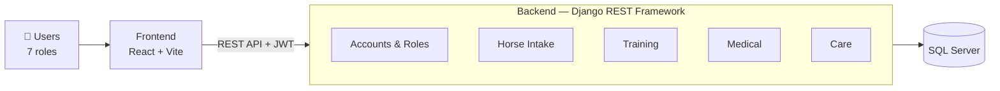

<div align="center">


# EquiTrack — Racehorse Training & Management System

*A full-stack web application for managing a horse racing club: horse intake, training, medical care and daily care.*


</div>

---

## Overview

EquiTrack is a full-stack web application designed to digitize and streamline the daily operations of a horse racing club, covering the whole lifecycle of a racehorse: intake and registration, training, medical care and daily care. The system serves seven user roles—Club Manager, Head Trainer, Trainer, Work Rider, Veterinarian, Groom and Horse Owner—each working in its own workspace within a unified React frontend, backed by a Django REST API and a SQL Server database.

This software solution was engineered as a capstone fulfillment for the SWP391 – Software Development Project curriculum at FPT University Ho Chi Minh City (Fall 2026).

## System Architecture



| Layer | Technology | Responsibility |
|---|---|---|
| **Presentation** | React 19 · Vite 8 · React Router 7 · JavaScript + TypeScript | User interface and a workspace for each of the 7 roles |
| **API** | Django REST Framework · SimpleJWT · drf-spectacular (Swagger) | Receives requests, authenticates users, checks role permissions |
| **Business** | Django 5.2 apps: `accounts`, `horses`, `training`, `medical`, `care`, `core` | Business rules of the four modules: horse intake, training, medical care and daily care |
| **Data** | SQL Server 2019+ (`mssql-django`, ODBC Driver 17/18) | Stores data with constraints and triggers (`sql/horse_v2.sql`) |

## Project Structure

```
Equine_Project/
├── backend/                     # Django REST API
│   ├── apps/
│   │   ├── accounts/            # users, roles, authentication
│   │   ├── horses/              # horse intake: registration, examination, stalls
│   │   ├── training/            # training: assessment, plans, sessions
│   │   ├── medical/             # medical: records, treatments, vaccinations
│   │   ├── care/                # daily care: diet, care tasks, inventory
│   │   └── core/                # shared: permissions, notifications, audit log, tests
│   ├── config/                  # Django settings
│   ├── docs/API.md              # API contract for the frontend
│   ├── manage.py
│   └── requirements.txt
├── frontend/                    # React + Vite web app
│   ├── public/
│   └── src/
│       ├── api/                 # calls to the backend
│       ├── components/          # shared components
│       └── pages/               # landing, manager, owner, vet
├── sql/
│   └── horse_v2.sql             # database script
└── README.md
```

## Getting Started

**Trạng thái source hiện tại:** Backend đã có tiếp nhận, huấn luyện, y tế và chăm sóc; frontend có các không gian làm việc theo vai trò. Không gian thú y đã được hoàn thiện quy trình khám, đơn thuốc, bệnh án, báo cáo, khóa tập và lịch theo API hiện có. Xem [bàn giao thú y và giới hạn backend/asset](backend/docs/VET_WORKSPACE_20261022.md), [contract FE–BE](backend/docs/API.md) và [hướng dẫn backend](backend/README.md). Các bảng và kết quả tích hợp ngày 16/10 bên dưới là lịch sử, không thay thế source và báo cáo kiểm chứng mới nhất.

### Prerequisites

- **SQL Server** 2019+ and **SSMS**
- **Microsoft ODBC Driver** 17 or 18 for SQL Server
- **Python** 3.12+
- **Node.js** 20.19+ or 22.12+ (npm included)

### Default Ports

| Service | Port | URL |
|---|---|---|
| Frontend (Vite) | 5173 | http://localhost:5173 |
| Backend API | 8000 | http://127.0.0.1:8000/api |
| Swagger UI | 8000 | http://127.0.0.1:8000/api/docs |
| Health check | 8000 | http://127.0.0.1:8000/api/health |
| SQL Server | 1433 | `localhost\SQLEXPRESS` |

### Chạy bản tích hợp bằng PowerShell

Backend (terminal riêng):

```powershell
Set-Location C:\Equine_Project\backend
.\.venv\Scripts\python.exe manage.py check
.\.venv\Scripts\python.exe manage.py runserver 127.0.0.1:8000
```

Frontend (terminal riêng):

```powershell
Set-Location C:\Equine_Project\frontend
npm.cmd ci
npm.cmd run dev
```

Seed, chỉ trên database local/demo đã xác định:

```powershell
Set-Location C:\Equine_Project\backend
.\.venv\Scripts\python.exe manage.py seed_demo
```

Mật khẩu sinh ngẫu nhiên khi chạy hoặc lấy từ `EQUI_DEMO_PASSWORD`. Tài khoản cũ giữ nguyên mật khẩu. Không chạy migrate/makemigrations hoặc chạy lại SQL tạo database hiện có. `.env` và `.env.local` không bị ghi đè trong lần tích hợp này.

Biến cấu hình: FE dùng `VITE_API_BASE_URL=/api`, `VITE_API_PROXY_TARGET=http://127.0.0.1:8000`; BE dùng `DJANGO_SECRET_KEY`, `DJANGO_DEBUG`, `DJANGO_ALLOWED_HOSTS`, `DB_HOST`, `DB_NAME`, `DB_USER`, `DB_PASSWORD`, `DB_ODBC_DRIVER`, `DB_EXTRA_PARAMS`, `CORS_ALLOWED_ORIGINS`. Các giá trị mẫu không chứa bí mật nằm trong hai file `.env.example`; không cần `VITE_REGISTER_ENDPOINT`.

Kiểm thử backend không ghi vào SQL Server:

```powershell
Set-Location C:\Equine_Project\backend
.\.venv\Scripts\python.exe manage.py test apps.core.tests --settings=config.settings_test --noinput
```

Các script kiểm thử FE, contract và phạm vi chưa hỗ trợ được ghi trong [frontend/README.md](frontend/README.md), [backend/README.md](backend/README.md), [backend/docs/API.md](backend/docs/API.md).

### Tệp thay đổi trong lần tích hợp

| Nhóm file | Mục đích |
|---|---|
| `frontend/src/components/layout/LoginScreen.jsx`, `LoginScreen.css`, `src/api/registrationApi.js` | Giao diện ZIP, animation/responsive, đăng ký Owner với địa chỉ và CLB theo API thật |
| `frontend/src/App.jsx`, `src/pages/manager/CreateHorse.jsx`, `src/index.css` | Merge LoginScreen, sửa import OwnerHorseForm/roleLabels và conflict CSS cũ; nối form Manager vào client chung, tải lại lịch sử/chuồng |
| `frontend/src/api/apiClient.ts`, `horseApi.ts`, `userApi.ts`, `health.js`, `src/types/index.ts` | Một bộ token/API, refresh đồng thời, lỗi 401/403/validation, payload/role đúng contract |
| Các bản `apiClient.js`, `horseApi.js`, `userApi.js`, `authApi.js`, `src/config/api.js`, `VetExaminationForm.jsx` | Gỡ sau khi xác nhận không còn import; bản TS là nguồn dùng chung |
| `frontend/tests/api.test.mjs`, `package.json`, `.oxlintrc.json`, `.env.example`, `README.md` | Test adapter, kiểm tra biến chưa khai báo, cấu hình và hướng dẫn chạy |
| `backend/apps/medical/{__init__,apps,models,serializers,services,views,urls}.py` | Khôi phục có chọn lọc khám đầu vào từ Git; giữ permission và quyền sở hữu nháp; không bật Flow 3 đầy đủ |
| `backend/apps/core/management/commands/seed_demo.py`, `apps/core/tests/test_seed_demo.py` | Merge seed ZIP, bỏ phụ thuộc module thiếu, giữ mật khẩu và kiểm tra chạy lại không trùng |
| `backend/config/settings.py`, `config/urls.py`, `apps/horses/services.py`, `apps/core/notifications.py` | Chỉ nạp module Flow 1 có thật, lưu trữ/trả chuồng và thông báo không import training/care thiếu |
| `backend/apps/core/tests/test_medical_and_profile.py`, `test_schema_matches_sql.py` | Kiểm thử nháp của lần đăng ký cũ; phân biệt schema Flow 1 với các bảng Flow 2–4 chưa có model |
| `README.md`, `backend/README.md`, `backend/docs/API.md`, `backend/.env.example` | Phạm vi, bảng contract, lệnh chạy, seed và biến môi trường không chứa bí mật |

### Kết quả kiểm chứng ngày 16/10/2026

- FE: build, typecheck và 10 test API qua; lint không có lỗi, còn 8 cảnh báo `set-state-in-effect` từ các luồng đã có trước lần tích hợp.
- BE: Django check qua; 78 test chạy trên SQLite test, 77 qua và 1 bỏ qua vì specialization thuộc Flow 2 chưa cài. Schema OpenAPI được sinh và validate; chế độ `--fail-on-warn` vẫn báo lỗi do thiếu mô tả serializer ở các APIView cũ, nên không coi đây là schema hoàn chỉnh.
- SQL Server local `localhost\SQLEXPRESS`, database `RacehorseTrainingManagement`: kiểm tra cột các model trước seed, chạy seed hai lần, xác nhận không trùng và giữ nguyên mật khẩu/ngựa có sẵn. Không chạy migrate hoặc SQL tạo database.
- Chrome qua Vite → Django → SQL Server: public registration/login Owner, tạo/sửa/gửi lại sau từ chối, Manager xác minh, Vet lưu/mở lại nháp và ký, Vet khác bị chặn, Manager cấp mã/xếp chuồng/duyệt sửa/lưu trữ; kiểm tra reload và refresh token thật. Manager dùng JWT kiểm thử của tài khoản có sẵn để giữ nguyên mật khẩu; chưa kiểm thử nhập mật khẩu Manager cũ.
- Dữ liệu kiểm thử local được giữ lại: một Owner tên `Integration Owner` và ngựa `HorseID=9` đã Archived. Không xóa dữ liệu cũ. Đã kiểm tra form ở 390px/1440px và reduced motion; email SMTP và Google login chưa kiểm thử end-to-end.

## Team


| Student ID | Name | GitHub | Role |
|---|---|---|---|
| QE190148 |Trần Thu Hằng | [@tabu222](https://github.com/tabu222) | Backend |
| — |Nguyễn Đoàn Bạch Dương | [@bachduong0107](https://github.com/bachduong0107) | Backend |
| — |Hà Việt Tiến | [@tien105](https://github.com/tien105) | Frontend |
| — |Đặng Vi Bảo Minh | [@dangvibaominh-hub](https://github.com/dangvibaominh-hub) | Frontend |

---

<div align="center">

*SWP391 — FPT University Ho Chi Minh City · For academic purposes only.*

</div>
